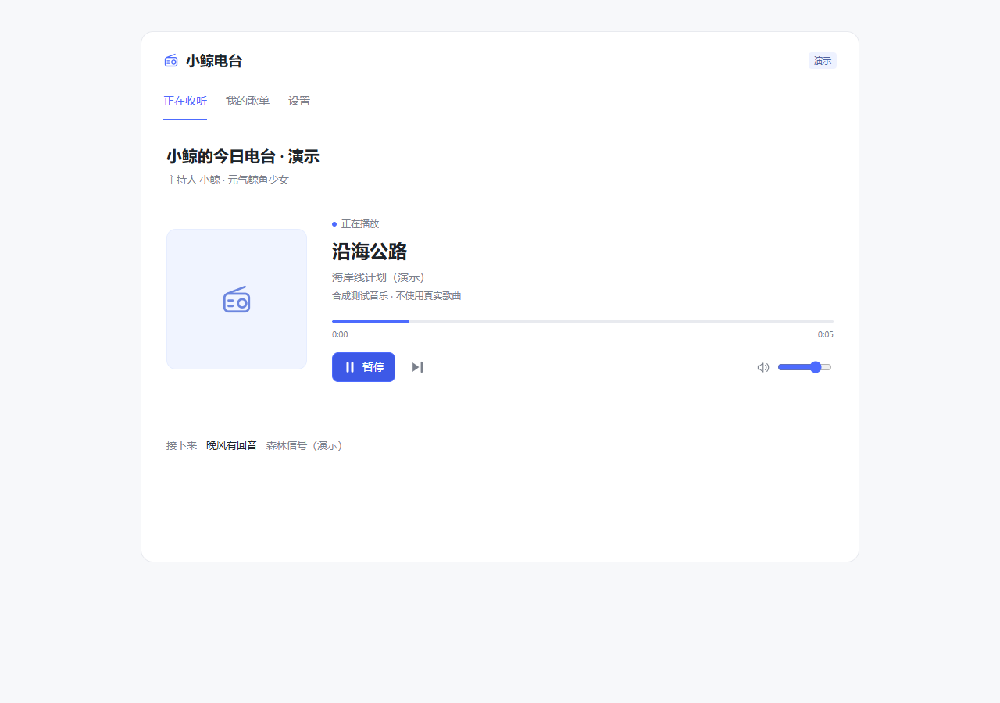

# 小鲸电台 · dsh-ai-radio

运行在 DeepSeek Harness / DSH Desktop 中的私人音乐电台。选择网易云歌单或每日推荐，让元气鲸鱼少女「小鲸」先准备整期节目，再陪你听歌。

## 0.2.5

- **先策划，后开播**：检索整份歌单的歌曲与歌手资料，结合当天新闻、天气、当前时间、收听历史与人设，由 AI 编排完整播放顺序、节目章节和逐首串词。编导可以提出扩展搜索，再按章节完成整篇演出稿。
- **自然少女声**：默认使用 Edge 晓伊神经网络音色，无需密钥；支持晓晓等音色。预设社区「蓝色大肥鱼」Fish Audio 音色，填入自己的 Key 后可切换。保留其他兼容语音服务。
- **连续的音乐与口播**：舒缓背景乐下问候听众 → 介绍第一首 → 音乐渐入。开播前生成口播、测量实际时长，安排覆盖上首尾奏与下首前奏的时间点。歌曲按自己的时间线交叉衔接，主持人没有说完也不延后下一首；开口前约 1.2 秒先平滑压低音乐，结束后再恢复。
- **界面精简**：蓝白配色，继承 DSH 字体变量，只保留「正在收听 / 我的歌单 / 设置」。新闻与收听记录继续参与节目编排，不再各占一个页面。
- **每日推荐**：「我的歌单」顶部可以读取当前网易云账号的每日推荐歌曲，一键策划今日电台，也能切回自选歌单。按中国日期缓存，支持手动刷新；次日重新开台会读取当天推荐。
- **聊天式主持**：短报幕、生活小观察、查证趣闻和前后呼应交替；不再逐首解释歌词、念专辑资料或强行升华。至少约三分之一是短报幕，给音乐留空间。设置中可先预览开场与三段口播，再决定是否开台。

**0.2.1 开台修复**：处理模型思考耗尽生成额度造成的截断，按模型支持情况分配推理与写稿预算；保存已完成的编导和章节，失败重试接着写。进度会显示模型仍在思考或写稿、已用时间；连接暂时中断会自动恢复。准备期间先播放舒缓底乐，可以暂停，不会把暂停变成取消策划。

**0.2.4 音色修复**：所选服务缺少 Key 或合成失败时明确提示并保留音乐，不再改用其他声音。旧版按 Fish 配置缓存的 Edge 替代音频不会复用；切换音色也会取消仍在等待的旧口播。

## 安装

需要 Node.js 20.19+，以及提供 webServer、llm 和 Web UI slots 的 DSH Web / Desktop。

### DSH Desktop

打开 **插件 → 添加插件**，输入：

    github:txpoki/dsh-ai-radio#main

也可填写本地安装包 **dsh-ai-radio-0.2.5.tgz** 的完整路径。

安装、启用后，**完整退出并重新启动 DSH Desktop**。更新已有版本时尤其需要这一步：仅开关插件或刷新界面，后台仍可能缓存旧模块。desktop profile 由 Electron 应用管理，使用内置插件管理器安装。

聊天输入框下方会出现「小鲸电台」入口。

### Web / 命令行 profile

    dsh plugin --profile web add "github:txpoki/dsh-ai-radio#main"

将 web 换成实际命令行 profile；GitHub 源安装需要 Git 已加入 PATH。

## 开始今天的电台

1. 打开「我的歌单」，用网易云音乐 App 扫码登录；也可导入自己的登录 Cookie。
2. 点击 **从每日推荐开始今日电台**，或在歌单旁点击 **从这个歌单开始今日电台**；多个歌单可勾选后一起开始。
3. 小鲸先逐首查资料、构思整期顺序、扩展查证，再分章写完开场和每首歌的串场，生成语音并校准衔接时间。界面显示真实阶段、模型活动与已用时间，同时铺上舒缓底乐。长歌单首次准备可能需要数分钟；完成的编导、章节与语音会保存，重试会继续已有工作。
4. 整期稿件准备好后自动开播，无需再点一次播放。开场背景音乐、主持问候、第一首介绍和歌曲依次进入。

首次点击用于解锁浏览器音频。暂停后可以继续，支持切歌、锁屏媒体控制和跨标签页播放锁；刷新页面不会自动发声。歌曲无法播放时跳过；已编排的节目持续播放，接近结尾时后台准备下一期，准备失败则继续复用已有稿件，并移除过期或已播新闻。

每日推荐需要已登录的网易云账号。打开入口或刷新推荐只读取列表，点击开始后才作为电台曲库。它与自建/收藏歌单是两个来源，切换时保留原来的歌单勾选。登录过期或当日推荐为空会给出提示；按账号原有权限播放，不绕过试听或会员限制。接口兼容性参考 [MusicBox 的每日推荐实现](https://github.com/darknessomi/musicbox/blob/master/NEMbox/api.py)，实际可用性取决于网易云接口和账号状态。

## 主持音色

默认 **自然少女声 → 晓伊**；「设置」里可保存并直接试听。语速默认 1.02×，音调轻微上扬。

**大肥鱼预设**来自开源项目 [dafeiyu-ai-vtuber 的配置](https://github.com/zbsdsb/dafeiyu-ai-vtuber/blob/dafeiyu/config.json)：

| 配置 | 值 |
|---|---|
| 服务 | Fish Audio |
| 音色 | 蓝色大肥鱼 |
| Reference ID | fe50cdf3040449298470d58ff0991e1d |
| 默认模型 | s2.1-pro-free |

此预设需要自己的 Fish Audio Key，是否可用以及额度以服务商为准；本仓库不分发该声音的模型权重或参考录音。[Fish 官方接口](https://docs.fish.audio/api-reference/endpoint/openapi-v1/text-to-speech)提供模型与韵律参数说明。

Fish Studio 网页中选择的声音不会自动同步到插件。使用其他声音时，将该声音的 Model ID 填入「Fish 音色 ID」，再填写自己的 Fish API Key 并保存；仅选择服务或填写音色 ID 不会完成 API 鉴权。默认模型仍为 `s2.1-pro-free`。无需密钥时请选择自然少女声。

相关插件研究：[dsh-voice-horn](https://github.com/1DAdidi/dsh-voice-horn) 和 [dsh-dafeiyu-emotion](https://github.com/LiDu-china/dsh-dafeiyu-emotion) 都采用过 Edge 在线自然语音；本插件独立合成，不需要同时安装它们。

口播文本会发送至所选语音服务。Edge 会读取现有代理环境变量；Windows 没有对应变量时，读取已启用的系统代理，不修改系统设置。语音请求排队合成，实际音频时长用于安排口播；磁盘缓存可在重启后复用，按容量清理旧音频。服务缺少密钥、限流或故障时保留音乐并显示原因，不会替换成其他音色，未能测量的片段先用估计时长安排。设置会显示最近使用的音色服务；Fish 的密钥无效、权限/额度不足和音色不存在会给出不同提示。

## 策划与节目稿

优先复用 DSH 的 web 搜索服务及其已配置提供方；独立预览没有该服务时可使用公开 Bing RSS 搜索。模型不能凭记忆冒充搜索结果：每首背景保留来源 URL、摘要与检索时间；没有可靠资料的歌曲只介绍已知歌名、歌手和专辑。

编导先决定全歌单顺序、章节与编辑说明，再按每章最多 8 首撰写完整稿件。编导使用模型支持的高推理档，写稿使用较轻推理档，并为思考与正文保留足够的总生成额度。歌曲 ID 只能来自实际曲库，缺失曲目会补齐，防止大歌单被截成四首。播放阶段按既定顺序领取稿件，四首只是传输批量，不会临场重新随机选四首。

0.2.5 把普通聊天与音乐事实分开生成：没有资料时仍能聊一个日常小观察，关于艺人和作品的事实则必须对应来源。检索更偏向本人访谈、录音故事和创作趣事，减少歌词释义结果。短报幕由系统保留，故事占比受限，前后呼应会带入最近的串词；提示词版本变化会使旧稿缓存失效，下一次开台按新风格策划。

写作方法参考 [NPR 的口语写稿建议](https://www.gpb.org/news/2023/02/17/need-write-toast-or-script-here-are-7-tips-let-your-voice-shine-through)、[港台《音乐情人》的开场](https://www.rthk.hk/radio/radio2/programme/musiclover/episode/1126405)和 [KEXP 的歌曲故事示例](https://www.kexp.org/read/2017/06/21/song-of-the-gay-courtney-barnett-how-to-boil-an-egg/)。提炼的是常用词、一句一个意思、具体小细节和留白；仓库里的示例为原创，不复制主持人的固定文案或个性表达。

在 **设置 → 主持人设 → 预览三段口播** 可试写当前曲库的前三首，使用已保存的模型和当前编辑的人设。预览不启动音乐、不替换整期节目；它会进行至多三首的资料检索和一次模型写稿，便于先比较语气。口语自然程度仍取决于所用模型及资料质量。

默认人设与编导规范位于 [lib/prompts.js](lib/prompts.js)；也可在「设置 → 主持人设」修改。新闻取当前时区当天的 RSS，附媒体与原文来源；开场问候和第一首介绍之间不插新闻。轻松一刻按节目节奏编排。

完整稿件、全歌单顺序、预计音乐与口播时间及来源会保存在插件本机数据目录。实际播放还会按音频元数据校准，手动切歌会重新衔接。可在设置里 **下载本期完整节目稿**，无须显示额外资讯页面。

## 开发与验证

    pnpm install
    pnpm build
    pnpm check
    pnpm test
    pnpm test:browser
    pnpm test:startup
    pnpm test:mix
    pnpm test:daily
    pnpm test:voice
    pnpm test:editorial

    # 本地演示
    pnpm demo

演示仅监听 127.0.0.1。演示曲名、歌手、新闻是明确标注的测试数据，音乐与提示音为程序生成，不能代替真实账号、真实模型和真实 TTS 的验证。构建后的 lib/client.js 已提交，安装时无需用户编译。

运行记录见 [docs/verification.md](docs/verification.md)。

## 数据与播放权限

- 登录 Cookie、Key、收听记录、当日推荐缓存、音乐资料和节目稿保存在本机插件数据目录，默认 ~/.dsh/ai-radio；不会提交至 GitHub。浏览器只能获得密钥是否已设置的状态。
- 策划时所选歌单的歌曲、收听偏好、天气城市与补充说明会发给已配置的主持模型；音乐查询会发给搜索提供方。
- 音乐按本人网易云账号实际权限取链；试听片段、无版权或取链失败曲目跳过，不绕过 VIP、数字专辑或地区限制。
- 后台接口位于 /dsh-ai-radio/，写请求要求同源 JSON。卸载会清理播放资源、路由和任务。
- 默认背景乐由本项目自行合成，不含下载的商用音乐或第三方采样。

MIT；第三方来源见 [THIRD_PARTY_NOTICES.md](THIRD_PARTY_NOTICES.md)。软件许可不覆盖第三方歌曲、音色与 API 服务的权利。
